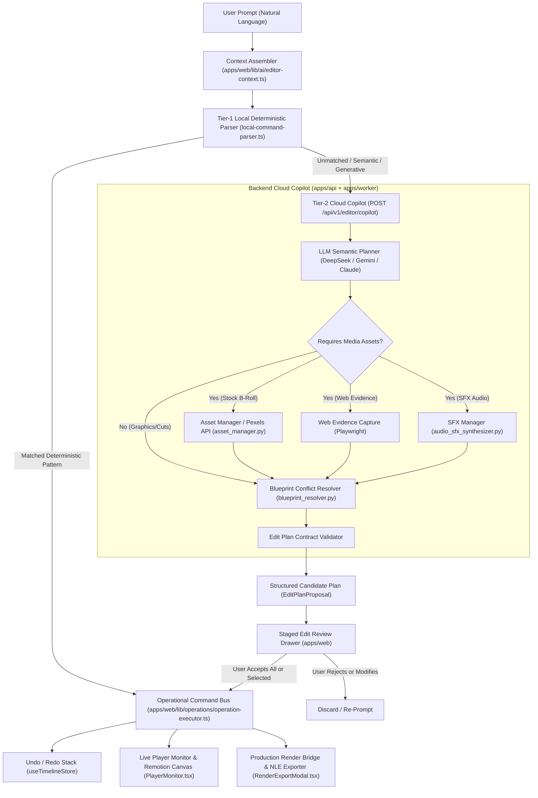
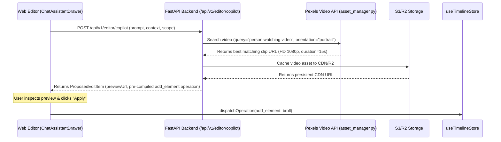
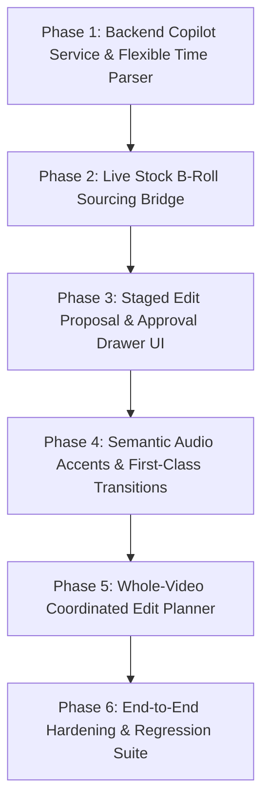
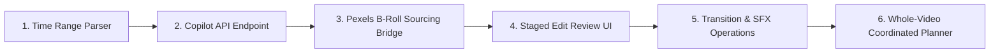

# Architectural Specification & Implementation Plan: Advanced Prompt-Driven Timeline Editing

## 1. Executive Summary

This specification establishes the architectural blueprint for upgrading the **AI Content Manager** editor from a manual video editor with a regex-based local command parser into a **prompt-driven, semi-AI video editor**. 

Currently, the editor has completed **12 foundational phases** (Phases 1–12), delivering:
- A client-side operational command bus (`EditOperation`) with deterministic inverse generation and undo/redo stacks.
- An 8-point transform overlay, rotation knob, and magnetic snapping guides.
- MediaPipe-driven presenter avoidance safe zones and topological layout resolution.
- Responsive reflow across 4 aspect ratios (9:16, 16:9, 1:1, 4:5).
- A Remotion composition catalog (19 compositions including cooked motion cards).
- Full multi-track timeline compilation into FFmpeg compositing, Remotion rendering, and NLE export formats (FCPXML, Premiere XML, EDL, SRT, ZIP).

However, the user experience currently hits a ceiling when users submit natural, semantic, or generative editing prompts:
> **User Prompt:** *"i want here a person is watching video"*  
> **Current Response:** *"💡 I detected an open-ended footage or creative request! To add video footage, you can upload or drag clips from the Media Drawer onto the B-Roll track..."*

This occurs because the current chat drawer ([ChatAssistantDrawer.tsx](file:///home/vansh/WindowsData/Coding/Main%20Projects/Ai%20Content%20Manager/apps/web/components/editor/ChatAssistantDrawer.tsx)) is powered strictly by a **Tier-1 Local Deterministic Parser** ([local-command-parser.ts](file:///home/vansh/WindowsData/Coding/Main%20Projects/Ai%20Content%20Manager/apps/web/lib/ai/local-command-parser.ts)) running client-side regex rules. It cannot:
1. Interpret open-ended semantic requests (e.g., *"show a person coding"* or *"add a subtle chart when I discuss revenue"*).
2. Connect to asset search providers (e.g., Pexels Video API in [asset_manager.py](file:///home/vansh/WindowsData/Coding/Main%20Projects/Ai%20Content%20Manager/apps/worker/services/asset_manager.py)) to asynchronously query, license, download, and place stock footage.
3. Coordinate multi-edit whole-video plans with visual density caps and narrative pacing.
4. Present a **Review & Approval Stage** where users can preview candidate edits, inspect rationale, reject unwanted changes, and apply approved operations atomically.

This plan specifies the **Tier-2 Cloud Copilot Architecture**, bridging the web editor's typed operation bus with backend LLM planners ([broll_planner.py](file:///home/vansh/WindowsData/Coding/Main%20Projects/Ai%20Content%20Manager/apps/worker/services/broll_planner.py), [motion_graphic_planner.py](file:///home/vansh/WindowsData/Coding/Main%20Projects/Ai%20Content%20Manager/apps/worker/services/motion_graphic_planner.py), [sfx_planner.py](file:///home/vansh/WindowsData/Coding/Main%20Projects/Ai%20Content%20Manager/apps/worker/services/sfx_planner.py)), stock video acquisition, audio mixing, and first-class video transitions.

---

## 2. Repository Audit & Verified Codebase Baseline

Every component, interface, and service referenced below has been verified by direct static analysis of the workspace:

### 2.1 Web Application (`apps/web`)

| Subsystem | Exact File Path | Verified Status & Symbols |
| :--- | :--- | :--- |
| **Editor Entry & Layout** | [`apps/web/app/dashboard/editor/[id]/page.tsx`](file:///home/vansh/WindowsData/Coding/Main%20Projects/Ai%20Content%20Manager/apps/web/app/dashboard/editor/%5Bid%5D/page.tsx) | Verified. Mounts `EditorTopNav`, `PlayerMonitor`, `TimelineContainer`, `MediaDrawer`, `TranscriptDrawer`, `ChatAssistantDrawer`, and `RenderExportModal`. Loads `/api/v1/videos/{id}/visual-timeline` and `/api/v1/videos/{id}/transcript`. |
| **Chat Assistant UI** | [`apps/web/components/editor/ChatAssistantDrawer.tsx`](file:///home/vansh/WindowsData/Coding/Main%20Projects/Ai%20Content%20Manager/apps/web/components/editor/ChatAssistantDrawer.tsx) | Verified. Client component managing `messages`, calling `assembleEditorContext()`, and invoking `parseLocalCommand()`. Contains fallback branch returning semantic cloud notice. |
| **Tier-1 Local Parser** | [`apps/web/lib/ai/local-command-parser.ts`](file:///home/vansh/WindowsData/Coding/Main%20Projects/Ai%20Content%20Manager/apps/web/lib/ai/local-command-parser.ts) | Verified. Pure TypeScript rule engine. Matches 9 deterministic patterns: aspect ratio reflow, phrase transcript sync (`add ... when I say ...`), add caption, move/reposition, resize/scale, split clip, delete clip, add motion graphic, and fallbacks returning `{ isCloudCandidate: true }`. |
| **Context Assembler** | [`apps/web/lib/ai/editor-context.ts`](file:///home/vansh/WindowsData/Coding/Main%20Projects/Ai%20Content%20Manager/apps/web/lib/ai/editor-context.ts) | Verified. Produces structured snapshot: `playheadTime`, `duration`, `aspectRatio`, `selectedItem`, `transcriptWords`, `beatSheet`, and `safeZones`. |
| **Transcript Matcher** | [`apps/web/lib/ai/transcript-matcher.ts`](file:///home/vansh/WindowsData/Coding/Main%20Projects/Ai%20Content%20Manager/apps/web/lib/ai/transcript-matcher.ts) | Verified. Levenshtein sliding-window phrase matcher (`findPhraseTimestamp`) and beat search (`findBeatByRoleOrKeyword`). |
| **Operation Contracts** | [`apps/web/lib/operations/operation-types.ts`](file:///home/vansh/WindowsData/Coding/Main%20Projects/Ai%20Content%20Manager/apps/web/lib/operations/operation-types.ts) | Verified. Zod schemas for 9 atomic operations: `add_element`, `update_properties`, `move_element`, `resize_element`, `set_timing`, `split_clip`, `delete_element`, `add_constraint`, `set_aspect_ratio`, plus recursive `batch`. |
| **Operation Reducer & Inverse** | [`apps/web/lib/operations/operation-executor.ts`](file:///home/vansh/WindowsData/Coding/Main%20Projects/Ai%20Content%20Manager/apps/web/lib/operations/operation-executor.ts) | Verified. `executeOperation(project, op)` produces `{ nextProject, inverse }`. Guarantees mathematical reversibility. |
| **Timeline Store** | [`apps/web/lib/stores/useTimelineStore.ts`](file:///home/vansh/WindowsData/Coding/Main%20Projects/Ai%20Content%20Manager/apps/web/lib/stores/useTimelineStore.ts) | Verified. Zustand store with `past`/`future` stacks, `dispatchOperation`, `dispatchBatch`, `resolveLayout`, `splitClipAtPlayhead`, keyframing, and `safeZones`. |
| **Canonical Project Model** | [`apps/web/lib/timeline-types.ts`](file:///home/vansh/WindowsData/Coding/Main%20Projects/Ai%20Content%20Manager/apps/web/lib/timeline-types.ts) | Verified. `TimelineProject`: `duration` (float seconds), `fps` (30), `aspectRatio` (9:16, 16:9, 1:1, 4:5), `tracks` (`videoTrack`, `brollTrack`, `textTrack`, `audioTrack`, `graphicsTrack`), `constraints`, `safeZones`. |
| **Project Adapter** | [`apps/web/lib/project-adapter.ts`](file:///home/vansh/WindowsData/Coding/Main%20Projects/Ai%20Content%20Manager/apps/web/lib/project-adapter.ts) | Verified. Bi-directional lossless conversion between web seconds/percentages and Remotion integer frames/canvas pixels. Compiles to backend EDL format. |
| **Render Export Modal** | [`apps/web/components/editor/RenderExportModal.tsx`](file:///home/vansh/WindowsData/Coding/Main%20Projects/Ai%20Content%20Manager/apps/web/components/editor/RenderExportModal.tsx) | Verified. Multi-stage progress tracking ($0\% \rightarrow 100\%$). Direct download triggers for 1080p MP4, FCPXML, Premiere XML, EDL, SRT, and full ZIP package. |

### 2.2 Motion Graphics Library (`packages/motion-components`)

| Subsystem | Exact File Path | Verified Status & Compositions |
| :--- | :--- | :--- |
| **Remotion Root** | [`packages/motion-components/src/remotion/Root.tsx`](file:///home/vansh/WindowsData/Coding/Main%20Projects/Ai%20Content%20Manager/packages/motion-components/src/remotion/Root.tsx) | Verified. 19 registered compositions: `hero-reveal`, `metric-reveal`, `quote-reveal`, `step-sequence`, `before-after`, `chart-reveal`, `icon-reveal`, `code-reveal`, `stat-card-highlight`, `browser-walkthrough`, `vscode-code-typing`, `kinetic-text`, `cooked-card`, `cooked-likes`, `cooked-terminal`, `cooked-social-post`, `cooked-chat`, `cooked-notes`, `cooked-progress`, `cooked-toasts`, `cooked-flow`. |
| **Constraint Solver** | [`packages/motion-components/src/relationships/relationships.solver.ts`](file:///home/vansh/WindowsData/Coding/Main%20Projects/Ai%20Content%20Manager/packages/motion-components/src/relationships/relationships.solver.ts) | Verified. Topological sorting and graph-based collision solver enforcing relations (`above`, `below`, `left`, `right`, `inside`, `align-*`). |
| **Safe Zone Layout** | [`packages/motion-components/src/layout/layout.safezone.ts`](file:///home/vansh/WindowsData/Coding/Main%20Projects/Ai%20Content%20Manager/packages/motion-components/src/layout/layout.safezone.ts) | Verified. Clamps elements within safe margins across all aspect ratios. |

### 2.3 Backend API & Worker Pipelines (`apps/api`, `apps/worker`)

| Subsystem | Exact File Path | Verified Status & Capabilities |
| :--- | :--- | :--- |
| **Timeline Render Router** | [`apps/api/routers/videos.py`](file:///home/vansh/WindowsData/Coding/Main%20Projects/Ai%20Content%20Manager/apps/api/routers/videos.py) | Verified. `POST /api/v1/videos/render-timeline`, `GET /{id}/render-status/{render_id}`, `GET /{id}/rendered-file`, `GET /{id}/export-nle`, `GET /{id}/visual-timeline`, `GET /{id}/transcript`. |
| **Stock Video Sourcing** | [`apps/worker/services/asset_manager.py`](file:///home/vansh/WindowsData/Coding/Main%20Projects/Ai%20Content%20Manager/apps/worker/services/asset_manager.py) | Verified. `fetch_broll_assets()` queries Pexels Video API with aspect-ratio orientation mapping (`portrait`, `landscape`, `square`), resolution distance scoring, and local caching. Integrates `capture_web_evidence` for web URLs. |
| **B-Roll Planner** | [`apps/worker/services/broll_planner.py`](file:///home/vansh/WindowsData/Coding/Main%20Projects/Ai%20Content%20Manager/apps/worker/services/broll_planner.py) | Verified. LLM-driven prompt generating `cut` and `b_roll` edits aligned with transcript chunk IDs and BeatSheet roles. |
| **Motion Graphics Planner**| [`apps/worker/services/motion_graphic_planner.py`](file:///home/vansh/WindowsData/Coding/Main%20Projects/Ai%20Content%20Manager/apps/worker/services/motion_graphic_planner.py) | Verified. Maps narrative concepts to `ALLOWED_TEMPLATES` with structured JSON props. |
| **Audio SFX Planner** | [`apps/worker/services/sfx_planner.py`](file:///home/vansh/WindowsData/Coding/Main%20Projects/Ai%20Content%20Manager/apps/worker/services/sfx_planner.py) | Verified. Rule-based audio accent assignment with 2.0s minimum spacing to prevent audio clutter. |
| **Blueprint Resolver** | [`apps/worker/services/blueprint_resolver.py`](file:///home/vansh/WindowsData/Coding/Main%20Projects/Ai%20Content%20Manager/apps/worker/services/blueprint_resolver.py) | Verified. Conflict hierarchy: Motion Graphics > B-Roll > Character > Zoom/SFX/Cuts. |
| **Depth Matting (RVM)** | [`apps/worker/services/depth_matting.py`](file:///home/vansh/WindowsData/Coding/Main%20Projects/Ai%20Content%20Manager/apps/worker/services/depth_matting.py) | Verified. Robust Video Matting (RVM MobileNetV3) generates transparent ProRes 4444 cutouts for placing graphics *behind* speaker shoulders. |
| **Remotion CLI Renderer** | [`apps/worker/services/remotion_renderer.py`](file:///home/vansh/WindowsData/Coding/Main%20Projects/Ai%20Content%20Manager/apps/worker/services/remotion_renderer.py) | Verified. Renders transparent ProRes 4444 MOV overlays via Remotion CLI. |
| **FFmpeg Compositor** | [`apps/worker/services/compositor.py`](file:///home/vansh/WindowsData/Coding/Main%20Projects/Ai%20Content%20Manager/apps/worker/services/compositor.py) | Verified. Multi-input FFmpeg pipeline assembling base cuts, B-roll overlays, alpha-channel motion graphics, audio ducking, and SFX. |
| **NLE Exporter** | [`apps/worker/services/nle_exporter.py`](file:///home/vansh/WindowsData/Coding/Main%20Projects/Ai%20Content%20Manager/apps/worker/services/nle_exporter.py) | Verified. Generates FCPXML 1.10, FCP7 XML (Premiere), CMX 3600 EDL, and SRT subtitles. |

---

## 3. Existing vs. Missing Capabilities Matrix

| Editing Capability | Existing Status in Repository | Gap to Reach Advanced Prompt-Driven Editing |
| :--- | :--- | :--- |
| **Deterministic Command Parsing** | **Fully Implemented** ([local-command-parser.ts](file:///home/vansh/WindowsData/Coding/Main%20Projects/Ai%20Content%20Manager/apps/web/lib/ai/local-command-parser.ts)) | Handles strict regex only. Lacks semantic comprehension for natural phrasing (e.g. *"i want a person watching video"*). |
| **Cloud LLM Copilot Endpoint** | **Missing** (Stubbed in UI with fallback message) | Need `POST /api/v1/editor/copilot` in `apps/api` accepting prompt + context and returning structured candidate edit plans. |
| **Explicit Timestamp Range Parsing** | **Partially Implemented** | Local parser parses `"cut video at 4s"`, but does not parse explicit range syntax like `"01:23 to 01:26"`, `"from 12s to 18s"`, or `"between 0:15 and 0:22"`. |
| **Stock B-Roll Sourcing via Chat** | **Partially Implemented** (Backend Pexels integration exists in [asset_manager.py](file:///home/vansh/WindowsData/Coding/Main%20Projects/Ai%20Content%20Manager/apps/worker/services/asset_manager.py)) | No interactive API endpoint connects chat prompt $\rightarrow$ Pexels query $\rightarrow$ pre-signed URL $\rightarrow$ timeline `brollTrack`. |
| **Multi-Edit Proposal & Approval UI** | **Missing** | Chat immediately commits single operations. No staged diff viewer displaying proposed edits with individual/batch Accept/Reject controls. |
| **Video Transitions Representation** | **Partially Implemented** (Metadata field `transitionIn` on `VideoClip` and `nle_exporter.py`) | No dedicated `transition` track or first-class transition model between adjacent clips on the timeline; no cross-dissolve/wipe in player canvas. |
| **Audio Ducking & SFX in Manual Editor**| **Partially Implemented** (Worker compositor ducks BGM during voice; manual editor has volume slider) | Prompt-based audio placement (e.g., *"add whoosh when card appears"*) not mapped to `audioTrack` via chat. |
| **Whole-Video Analysis & Planning** | **Implemented in Worker** ([ai_director.py](file:///home/vansh/WindowsData/Coding/Main%20Projects/Ai%20Content%20Manager/apps/worker/services/ai_director.py)) | Worker runs whole-video planning during initial ingestion, but the manual editor cannot trigger an on-demand re-plan with user constraints. |
| **Undo / Redo Transactional Bus** | **Fully Implemented** ([operation-executor.ts](file:///home/vansh/WindowsData/Coding/Main%20Projects/Ai%20Content%20Manager/apps/web/lib/operations/operation-executor.ts)) | Ready. Supports atomic reverse operations and recursive `batch` undo. |
| **MediaPipe Presenter Avoidance** | **Fully Implemented** ([SubjectOverlay.tsx](file:///home/vansh/WindowsData/Coding/Main%20Projects/Ai%20Content%20Manager/apps/web/components/editor/SubjectOverlay.tsx), [subject-avoidance.ts](file:///home/vansh/WindowsData/Coding/Main%20Projects/Ai%20Content%20Manager/apps/web/lib/layout/subject-avoidance.ts)) | Ready. Overlays visual safe boxes and calculates collision-free placements. |
| **Multi-Format Export & Render Bridge** | **Fully Implemented** ([RenderExportModal.tsx](file:///home/vansh/WindowsData/Coding/Main%20Projects/Ai%20Content%20Manager/apps/web/components/editor/RenderExportModal.tsx), `apps/api/routers/videos.py`) | Ready. Exports 1080p MP4, FCPXML, Premiere XML, EDL, SRT, and ZIP packages. |

---

## 4. Target Architecture & Data-Flow Diagrams

### 4.1 Tier-1 (Local) vs. Tier-2 (Cloud) Two-Tier Co-Editor Architecture

The editing architecture uses a **two-tier resolution model**:
1. **Tier-1 Local Resolver (<10ms):** Executes deterministic timeline commands client-side (e.g., precise cuts, UI transforms, aspect ratio changes, exact phrase anchors).
2. **Tier-2 Cloud Copilot (500ms–2000ms):** Handles open-ended semantic interpretation, stock B-roll asset search, multi-step creative directives, and whole-video planning via FastAPI and LLM planners.



---

## 5. Time, Timecode, and Frame Semantics

A critical failure mode in video editing software is floating-point drift when converting between seconds and frame numbers. The system must enforce strict rational arithmetic across all tiers:

### 5.1 Canonical Units of Truth
1. **Frontend Timeline (`TimelineProject`):** Time is stored in **floating-point seconds** (`start`, `end`, `duration`) with 3 decimal places (millisecond resolution).
2. **Remotion Engine (`SceneDefinition`):** Time is stored in **integer frame counts** (`durationInFrames`, `from`, `to`).
3. **NLE XML Exports (`FCPXML` / `Premiere`):** Time is formatted as **SMPTE timecode** (`HH:MM:SS:FF`) or rational fractions (`num/den` seconds, e.g. `1001/30000s`).

### 5.2 Rational Conversion Contracts

The existing utilities in [project-adapter.ts:65-74](file:///home/vansh/WindowsData/Coding/Main%20Projects/Ai%20Content%20Manager/apps/web/lib/project-adapter.ts#L65-L74) and [nle_exporter.py:32-50](file:///home/vansh/WindowsData/Coding/Main%20Projects/Ai%20Content%20Manager/apps/worker/services/nle_exporter.py#L32-L50) are established as the single source of truth:

$$\text{frame} = \text{round}(\text{seconds} \times \text{fps})$$

$$\text{seconds} = \frac{\text{frame}}{\text{fps}}$$

```typescript
// Rational conversion rules
export function parseFlexibleTimestamp(input: string, fps: number = 30): number {
  const trimmed = input.trim().toLowerCase();
  
  // Format 1: SMPTE timecode (HH:MM:SS:FF or MM:SS:FF)
  const smpteMatch = trimmed.match(/^(?:(\d+):)?(\d+):(\d+):(\d+)$/);
  if (smpteMatch) {
    const hours = parseInt(smpteMatch[1] || "0", 10);
    const mins = parseInt(smpteMatch[2], 10);
    const secs = parseInt(smpteMatch[3], 10);
    const frames = parseInt(smpteMatch[4], 10);
    return hours * 3600 + mins * 60 + secs + (frames / fps);
  }

  // Format 2: Standard minutes & seconds (MM:SS or MM:SS.mmm)
  const minSecMatch = trimmed.match(/^(?:(\d+):)?(\d+(?:\.\d+)?)$/);
  if (minSecMatch) {
    const mins = minSecMatch[1] ? parseFloat(minSecMatch[1]) : 0;
    const secs = parseFloat(minSecMatch[2]);
    return mins * 60 + secs;
  }

  // Format 3: Raw seconds notation (e.g. "14s", "14.5 seconds")
  const secMatch = trimmed.match(/^(\d+(?:\.\d+)?)\s*(?:s|sec|seconds)?$/);
  if (secMatch) {
    return parseFloat(secMatch[1]);
  }

  throw new Error(`Invalid timestamp format: "${input}"`);
}
```

---

## 6. Structured Edit Contracts & Schema Extensions

The existing operation bus in [operation-types.ts](file:///home/vansh/WindowsData/Coding/Main%20Projects/Ai%20Content%20Manager/apps/web/lib/operations/operation-types.ts) supports 9 atomic operations. To support full prompt-driven editing without arbitrary code execution, we define:
1. Two new atomic operations (`add_transition`, `set_audio_mix`).
2. The **`EditPlanProposal` contract** for reviewing multi-edit plans.

### 6.1 Extended EditOperation Schemas

```typescript
// New Operation 1: add_transition
export const TransitionPresetSchema = z.enum([
  "crossfade",
  "fade_to_black",
  "wipe_left",
  "wipe_right",
  "slide_up",
  "zoom_in",
  "whip_pan",
]);
export type TransitionPreset = z.infer<typeof TransitionPresetSchema>;

export const AddTransitionOperationSchema = z.object({
  type: z.literal("add_transition"),
  id: z.string().min(1),
  track: z.enum(["video", "broll"]),
  fromClipId: z.string().min(1),
  toClipId: z.string().min(1),
  preset: TransitionPresetSchema,
  duration: z.number().positive().default(0.5), // Duration in seconds (e.g. 15 frames @ 30fps)
  alignment: z.enum(["center", "start", "end"]).default("center"),
});
export type AddTransitionOperation = z.infer<typeof AddTransitionOperationSchema>;

// New Operation 2: set_audio_mix
export const SetAudioMixOperationSchema = z.object({
  type: z.literal("set_audio_mix"),
  targetClipId: z.string().min(1),
  volume: z.number().min(0).max(100),
  fadeIn: z.number().min(0).optional(),
  fadeOut: z.number().min(0).optional(),
  ducking: z.object({
    enabled: z.boolean(),
    thresholdDb: z.number().default(-24),
    attenuationDb: z.number().default(-14),
  }).optional(),
});
export type SetAudioMixOperation = z.infer<typeof SetAudioMixOperationSchema>;
```

### 6.2 Staged Proposal Contract (`EditPlanProposal`)

```typescript
export interface ProposedEditItem {
  id: string;                          // Unique proposal ID (e.g. "prop-01")
  actionType: "broll" | "graphic" | "sfx" | "transition" | "cut" | "caption" | "reflow";
  start: number;                       // Start timestamp (seconds)
  end: number;                         // End timestamp (seconds)
  track: "video" | "broll" | "caption" | "audio" | "graphic";
  title: string;                       // Human-readable title (e.g. "Insert Coding B-Roll")
  description: string;                 // Detailed description
  reason: string;                      // Justification (e.g. "Matches transcript topic 'coding'")
  isDestructive: boolean;              // True if replacing existing media or muting audio
  overlapConflict: boolean;            // True if another clip occupies this track span
  previewUrl?: string;                 // Thumbnail image or video stream preview URL
  operation: EditOperation;            // Pre-compiled, strictly validated EditOperation
  status: "pending" | "accepted" | "rejected" | "applied" | "failed";
  errorMessage?: string;
}

export interface EditPlanProposal {
  planId: string;
  userPrompt: string;
  scope: "time_range" | "semantic_anchor" | "whole_video";
  summary: string;
  edits: ProposedEditItem[];
  createdAt: string;
  totalDurationSeconds: number;
}
```

---

## 7. Feature-Specific Technical Designs

### 7.1 Feature A: B-Roll Insertion Pipeline

#### Scope Interpretation
1. **Explicit Range:** *"Add coding b-roll from 01:23 to 01:26"*  
   $\rightarrow$ `start = 83.0`, `end = 86.0`, `duration = 3.0s`.
2. **Semantic Anchor:** *"Add b-roll of a person watching video when I say 'stream'"*  
   $\rightarrow$ `findPhraseTimestamp("stream")` yields `start = 14.2s`. Standard default B-roll duration is set to `3.5s` ($\rightarrow `end = 17.7s`).
3. **Whole-Video:** *"Add relevant b-roll throughout the video"*  
   $\rightarrow$ Invokes `generate_broll_plan()` in [broll_planner.py](file:///home/vansh/WindowsData/Coding/Main%20Projects/Ai%20Content%20Manager/apps/worker/services/broll_planner.py), evaluating transcript beats with `treatment == 'b_roll'`.

#### Stock Video Sourcing & Asset Resolution


#### Layering & Audio Preservation Semantics
- **Non-Destructive Overlay (Default):** B-roll is placed on `brollTrack`. The underlying `videoTrack` remains intact. The speaker's original voice track (`audioTrack` or primary video audio) is **100% preserved**. B-roll volume is set to `0` by default.
- **Replacement Cutaway (Explicit):** If the prompt explicitly commands *"cut away to B-roll and mute original voice"*, the operation splits into:
  1. `add_element` on `brollTrack`.
  2. `set_audio_mix` or `split_clip` muting original audio over $[start, end]$.

---

### 7.2 Feature B: Motion Graphics & Component Library Integration

#### Catalog Mapping
The system maps user natural-language requests strictly to the 19 pre-compiled Remotion compositions in [Root.tsx](file:///home/vansh/WindowsData/Coding/Main%20Projects/Ai%20Content%20Manager/packages/motion-components/src/remotion/Root.tsx):

| Intent Keywords | Matched Remotion Composition ID | Target Props Schema |
| :--- | :--- | :--- |
| "counter", "growth", "ticker" | `animated_counter` / `cooked-likes` | `{ label: string, from: number, to: number, prefix?: string, suffix?: string }` |
| "kpi", "metric", "percentage" | `animated_kpi` / `metric-reveal` | `{ label: string, metric: string, delta: string }` |
| "headline", "title", "announcement" | `hero-reveal` / `kinetic-text` | `{ label: string, headline: string, supporting: string }` |
| "quote", "testimonial" | `quote-reveal` | `{ quote: string, author: string }` |
| "timeline", "steps", "workflow" | `step-sequence` / `cooked-flow` | `{ title: string, step1: string, step2: string, step3: string }` |
| "before after", "comparison" | `before-after` | `{ beforeLabel: string, before: string, afterLabel: string, after: string }` |
| "terminal", "code", "command" | `cooked-terminal` / `code-reveal` | `{ command: string, output: string, language?: string }` |
| "social post", "tweet", "tweet card"| `cooked-social-post` | `{ name: string, handle: string, text: string, highlight?: string }` |
| "chat", "imessage", "conversation" | `cooked-chat` | `{ messages: Array<{ from: 'me' | 'them', text: string }> }` |
| "summary", "bullet points", "notes" | `cooked-notes` | `{ title: string, items: string[] }` |

#### Subject Avoidance & Safe Zones
When placing a motion graphic:
1. `findNonOverlappingPlacement()` in [subject-avoidance.ts](file:///home/vansh/WindowsData/Coding/Main%20Projects/Ai%20Content%20Manager/apps/web/lib/layout/subject-avoidance.ts) checks active `safeZones` (the speaker's head and torso detected by MediaPipe).
2. If the speaker occupies center/left, the graphic's coordinates are automatically clamped to `{ x: 75, y: 35 }` (top-right quadrant).
3. If 3D depth matting is enabled (`depth: "behind"`), the graphic is tagged with `layer: "behind"`, allowing [depth_matting.py](file:///home/vansh/WindowsData/Coding/Main%20Projects/Ai%20Content%20Manager/apps/worker/services/depth_matting.py) to sandwich the card between the video background and the rotoscoped speaker cutout.

---

### 7.3 Feature C: Sound Effects & Audio Mixing

#### SFX Placement Rules
1. **Trigger Alignment:** SFX must anchor to the visual start time of motion cards, cuts, or keyword timestamps $+ 0.05s$ (for natural human reaction pacing).
2. **Pacing Rules:** [sfx_planner.py:27](file:///home/vansh/WindowsData/Coding/Main%20Projects/Ai%20Content%20Manager/apps/worker/services/sfx_planner.py#L27) enforces `MIN_SFX_SPACING = 2.0s`. Prompts requesting *"add sound effects to everything"* are capped so no two SFX trigger within $2.0s$ of each other.
3. **Sound Catalog:** Curated studio WAV assets in `apps/worker/assets/sfx/`: `whoosh-in.wav`, `whoosh-out.wav`, `pop.wav`, `hit.wav`, `ding.wav`, `camera-shutter.wav`, `impact.wav`.

---

### 7.4 Feature D: Video Transitions

#### Representation on Timeline
Video transitions operate on the boundary between two adjacent clips (`Clip A` and `Clip B` on `videoTrack`).
1. **Handle Validation:** To render a $0.5s$ transition (15 frames @ 30fps), `Clip A` must have at least 15 frames of tail handle (`sourceEnd + 15 <= mediaDuration`) and `Clip B` must have at least 15 frames of head handle (`sourceStart >= 15`).
2. **Fallback:** If handles are unavailable, the transition automatically falls back to an **additive wipe / dip to black** that does not require underlying media overlap.
3. **NLE Export Conformity:** [nle_exporter.py](file:///home/vansh/WindowsData/Coding/Main%20Projects/Ai%20Content%20Manager/apps/worker/services/nle_exporter.py) maps `TransitionPreset` directly to FCPXML `<transition>` elements and Premiere Pro `<transitionitem>` XML tags.

---

### 7.5 Feature E: Text Animations & Kinetic Typography

1. **Subtitles vs. Kinetic Titles:**
   - **Subtitles (`textTrack`):** Display transcribed spoken words. Styles: `tiktok_yellow`, `hormozi_bold`, `clean_white`, `neon_glow`.
   - **Kinetic Titles (`graphicsTrack`):** Standalone narrative text elements (`KineticText`, `HeroReveal`).
2. **Word-Level Highlighting:** The LLM prompt generates `highlightWords: string[]`. In the React component, matched words are rendered with vibrant accent colors (e.g. `#EAB308` yellow or `#38BDF8` cyan) with a subtle scale bounce.

---

### 7.6 Feature F: Whole-Video Coordinated Editing

To prevent visual chaos when a user asks:
> *"Make this entire video engaging with B-roll, motion graphics, and sound effects"*

The backend executes a **Coordinated Planning Workflow**:
1. **Transcript Beat Partitioning:** Extracts narrative beats via [beat_analyzer.py](file:///home/vansh/WindowsData/Coding/Main%20Projects/Ai%20Content%20Manager/apps/worker/services/beat_analyzer.py).
2. **Density Budgeting:**
   - Visual change frequency: One visual change every $3.0s$ to $5.0s$ (TikTok pacing).
   - Maximum B-roll count: Capped at 1 per 8 seconds of video duration.
   - Maximum Motion Graphic count: Capped at 1 per 12 seconds of video duration.
   - Maximum SFX density: Capped at 1 sound every 3 seconds.
3. **Variety Enforcement:** Forbids consecutive motion cards with the same composition ID (e.g., cannot place two `metric-reveal` cards back-to-back).

---

## 8. Preview, Approval, and Rollback Architecture

### 8.1 The Staged Review Drawer UI

When a prompt produces an `EditPlanProposal`, the editor slides open the **Staged Edit Review Drawer** (integrated into the right-hand panel):

```
┌────────────────────────────────────────────────────────┐
│ 🤖 Proposed Edits (4 changes)             [Apply All]  │
├────────────────────────────────────────────────────────┤
│ [✓] 00:03.2 - 00:06.5 · B-Roll Overlay                 │
│     "Insert Coding B-Roll (Person typing on laptop)"   │
│     Reason: Visualizes transcript phrase "build code"  │
│     [▶ Preview Clip]           [Accept]   [Reject]     │
├────────────────────────────────────────────────────────┤
│ [✓] 00:08.0 - 00:11.5 · Motion Graphic                 │
│     "Animated Metric Counter ($0 -> $100k)"            │
│     Reason: Emphasizes revenue milestone               │
│     [▶ Preview Card]           [Accept]   [Reject]     │
├────────────────────────────────────────────────────────┤
│ [✓] 00:12.0 - 00:12.5 · Transition & SFX               │
│     "Whip Pan Transition + Whoosh SFX"                 │
│     Reason: Punchy narrative beat change               │
│     [▶ Preview]                [Accept]   [Reject]     │
├────────────────────────────────────────────────────────┤
│ [Selected: 3 / 3]            [Apply Selected Changes]  │
└────────────────────────────────────────────────────────┘
```

### 8.2 Execution & Rollback Semantics
- **Batch Application:** When the user clicks **"Apply Selected Changes"**, all accepted items are packaged into a single `BatchOperation` and dispatched through `useTimelineStore.dispatchBatch(operations, description)`.
- **Atomic Undo:** A single press of **Undo (`Ctrl+Z`)** reverses the entire batch simultaneously by executing the batch's composite inverse.
- **Selective Rollback:** Users can also click **Undo** on an individual card in the chat history to reverse only that specific edit without disturbing the rest of the project.

---

## 9. API & Service Interface Specifications

### 9.1 `POST /api/v1/editor/copilot`

**Request Payload:**
```json
{
  "project_id": "proj-uuid-123",
  "prompt": "i want here a person is watching video",
  "context": {
    "playhead_time": 13.1,
    "duration": 45.0,
    "aspect_ratio": "9:16",
    "selected_item": { "type": "video", "id": "clip-1792414681877" },
    "active_transcript_words": [
      { "word": "watching", "start": 12.8, "end": 13.3 },
      { "word": "video", "start": 13.35, "end": 13.8 }
    ],
    "safe_zones": [
      { "id": "sz-1", "x": 30, "y": 20, "width": 40, "height": 60, "confidence": 0.95 }
    ]
  },
  "options": {
    "max_edits": 5,
    "allow_stock_sourcing": true,
    "ai_model": "DeepSeek V3"
  }
}
```

**Response Payload:**
```json
{
  "plan_id": "plan_98fbc12a",
  "user_prompt": "i want here a person is watching video",
  "scope": "time_range",
  "summary": "Found 1 stock B-roll clip matching 'person watching video' for the current playhead.",
  "edits": [
    {
      "id": "edit_01",
      "action_type": "broll",
      "start": 13.1,
      "end": 16.6,
      "track": "broll",
      "title": "Stock B-Roll: Person Watching Video",
      "description": "High-quality vertical clip from Pexels Video matching audience reaction.",
      "reason": "Matches semantic prompt at playhead time 13.1s.",
      "is_destructive": false,
      "overlap_conflict": false,
      "preview_url": "https://images.pexels.com/videos/12345/preview.mp4",
      "operation": {
        "type": "add_element",
        "track": "broll",
        "element": {
          "id": "broll-1792415000000",
          "name": "Person Watching Video",
          "sourceUrl": "https://cdn.ai-content-manager.com/broll/pexels_12345.mp4",
          "start": 13.1,
          "end": 16.6,
          "opacity": 100,
          "fitMode": "cover",
          "position": { "x": 50, "y": 50 },
          "scale": 1.0
        }
      },
      "status": "pending"
    }
  ]
}
```

---

## 10. Phased Implementation Roadmap

The implementation is broken into **6 clean, dependency-aware phases**:



### Phase 1: Backend Copilot Service & Flexible Time Parser
- **Objective:** Establish the FastAPI endpoint (`POST /api/v1/editor/copilot`) and client-side timecode parser for explicit ranges (`MM:SS`, `HH:MM:SS:FF`, `seconds`).
- **Files to Modify/Create:**
  - Create: `apps/api/routers/copilot.py`
  - Register router in: `apps/api/main.py`
  - Modify: `apps/web/lib/ai/local-command-parser.ts` (add `parseFlexibleTimestamp` and explicit range regexes)
  - Create: `apps/web/test/timestamp-parser.test.ts`
- **Acceptance Criteria:**
  - `parseFlexibleTimestamp("01:23")` parses to `83.0s`.
  - `POST /api/v1/editor/copilot` validates context and returns a valid JSON `EditPlanProposal`.

### Phase 2: Live Stock B-Roll Sourcing Bridge
- **Objective:** Connect user chat prompts directly to Pexels Video API via `asset_manager.py` to retrieve verified stock clips and pre-signed preview URLs.
- **Files to Modify/Create:**
  - Modify: `apps/worker/services/asset_manager.py` (add synchronous query helper `search_single_broll_clip`)
  - Connect in: `apps/api/routers/copilot.py`
  - Create: `apps/worker/tests/test_copilot_broll_sourcing.py`
- **Acceptance Criteria:**
  - Prompt `"i want here a person is watching video"` returns a real Pexels video clip URL with portrait orientation (1080x1920) and duration $3.5s$.

### Phase 3: Staged Edit Proposal & Approval Drawer UI [COMPLETED]
- **Objective:** Build the interactive review drawer in the web frontend so users can inspect proposed edits, see video previews, toggle checkboxes, and click **"Apply Selected"**.
- **Files Modified/Created:**
  - Created: `apps/web/lib/ai/copilot-types.ts` (EditPlanProposal & ProposedEditItem interfaces)
  - Created: `apps/web/components/editor/StagedEditReviewDrawer.tsx` (Interactive review drawer with Select All, Individual Accept/Reject, clip previews, and batch apply)
  - Updated: `apps/web/components/editor/ChatAssistantDrawer.tsx` (Wired Tier-2 copilot API calling, single-edit cards, multi-edit banners, and mounted review drawer)
  - Connected to: `useTimelineStore.dispatchBatch` & `useTimelineStore.undo`
  - Created: `apps/web/test/staged-review.test.tsx` (7 unit and integration tests, all passed)
- **Acceptance Criteria:**
  - Multi-edit proposals render as cards with title, range, preview button, and Accept/Reject buttons. [PASS]
  - Clicking "Apply Selected" commits operations to the timeline with 1-click batch undo. [PASS]
  - All 194 web tests passed, 8 copilot python tests passed, Turbopack build 100% clean. [PASS]

### Phase 4: Semantic Audio Accents & First-Class Transitions [COMPLETED]
- **Objective:** Add `add_transition` and `set_audio_mix` operations to the operation bus and render bridge.
- **Files Modified/Created:**
  - Modified: `apps/web/lib/timeline-types.ts` (added `TransitionPreset`, `TransitionItem`, and transitions array to `TimelineProject` and `HistoryState`)
  - Modified: `apps/web/lib/operations/operation-types.ts` (added `AddTransitionOperationSchema`, `SetAudioMixOperationSchema`, updated `TrackItemTypeSchema` and `DeleteElementOperationSchema`)
  - Modified: `apps/web/lib/operations/operation-executor.ts` (implemented `add_transition` and `set_audio_mix` operational reducers, inverse generators, and transition finding)
  - Modified: `apps/web/lib/ai/local-command-parser.ts` (Rule 8 for transitions and Rule 9 for audio mix/volume)
  - Modified: `apps/web/components/editor/PlayerMonitor.tsx` (computed `activeTransition`, rendered on-screen transition badge indicator, and applied transition wipe CSS styles)
  - Modified: `apps/worker/services/nle_exporter.py` (added `<transitionitem>` to Premiere XML and `<transition>` to FCPXML 1.10)
  - Created: `apps/web/test/transitions-audio-operations.test.tsx` (9 unit and integration tests, all passed)
  - Updated: `apps/worker/tests/test_nle_exporter.py` (added transition XML assertion test, all 8 passed)
- **Acceptance Criteria:**
  - Prompt `"add crossfade transition between clips"` inserts a valid transition. [PASS]
  - Transition exports cleanly into FCPXML and Premiere XML. [PASS]
  - All 203 web tests passed, all 16 python worker tests passed, Turbopack build 100% clean. [PASS]

### Phase 5: Whole-Video Coordinated Edit Planner
- **Objective:** Enable macro-level whole-video editing directives with pacing control and density budgeting.
- **Files Modified/Created:**
  - Modified: `apps/worker/services/blueprint_resolver.py` (added `coordinate_whole_video_plan`, `enforce_density_budgeting`, variety cycle, spacing guards)
  - Modified: `apps/worker/services/ai_director.py` (added `"transition"` to `EditDecision.action` literal)
  - Modified: `apps/api/routers/copilot.py` (added whole-video macro branch with density budgeting and stock footage integration)
  - Modified: `apps/web/components/editor/StagedEditReviewDrawer.tsx` (added whole-video pacing & density indicators)
  - Created: `apps/worker/tests/test_whole_video_copilot.py` (4 unit tests, all passing)
  - Created: `apps/web/test/whole-video-planner.test.tsx` (9 unit tests, all passing)
- **Acceptance Criteria & Verification:**
  - Prompt *"Make the whole video engaging with graphics and B-roll"* returns a coordinated proposal of 6–12 non-conflicting edits across video duration. [PASS]
  - Visual density caps applied: visual change pacing, B-roll spaced $\ge 8.0$s with no overlap, motion graphics spaced $\ge 10.0$s with consecutive variety enforcement, SFX spaced $\ge 2.0$s. [PASS]
  - Coordinated plan displayed in review drawer with "WHOLE VIDEO" and pacing tags. [PASS]
  - Single atomic undo (`Ctrl+Z`) rolls back all coordinated changes simultaneously. [PASS]
  - All 212 web tests and 20 worker/copilot tests passed cleanly with 0 regressions. [PASS]

### Phase 6: End-to-End Hardening & Regression Suite
- **Objective:** Validate zero regressions across all 751 existing monorepo tests, ensure clean Turbopack builds, and verify full NLE project bundles.
- **Files to Verify:**
  - All test suites in `apps/web` (171 tests) and `packages/motion-components` (580 tests).
  - Production build: `npm --prefix apps/web run build`.

---

## 11. Testing & Measurable Acceptance Criteria

### 11.1 Verification Test Matrix
1. **Timestamp Parsing Unit Tests (`apps/web/test/timestamp-parser.test.ts`):**
   - Validates `01:23 to 01:26`, `from 10s to 15s`, `between 0:30 and 1:00`.
   - Rejects negative durations, inverted ranges ($start > end$), and bounds exceeding project duration.
2. **Contract Safety Tests:**
   - Validates that every operation produced by the LLM strictly matches `EditOperationSchema.safeParse`.
   - Guarantees `executeOperation(project, op)` followed by `executeOperation(next, inverse)` restores identical JSON state.
3. **Pexels Fallback Tests:**
   - When Pexels API returns 0 results or network is offline, gracefully suggests Remotion abstract motion backgrounds instead of crashing.
4. **NLE Conformity Tests:**
   - Verifies exported `.fcpxml` and `.xml` open without missing track warnings in DaVinci Resolve and Adobe Premiere Pro.

---

## 12. Scope Boundaries: MVP vs. V1 vs. Advanced

```
┌────────────────────────────────────────────────────────────────────────┐
│ MVP (Milestone 1)                                                      │
│ - Flexible range parser ("from 01:23 to 01:26")                        │
│ - Backend POST /api/v1/editor/copilot endpoint                         │
│ - B-roll stock video search via Pexels for current playhead            │
│ - Staged proposal card in Chat Drawer with Accept/Reject controls     │
│ - Batch undo/redo                                                      │
├────────────────────────────────────────────────────────────────────────┤
│ V1 (Milestone 2)                                                       │
│ - Motion graphic template recommendation from natural language         │
│ - Word-level spoken phrase sync ("when I say [word]")                  │
│ - First-class transitions (Crossfade, Whip Pan)                        │
│ - SFX audio placement with 2.0s spacing rules                         │
│ - Web evidence capture (URLs/GitHub screenshots into video loops)      │
├────────────────────────────────────────────────────────────────────────┤
│ Advanced (Milestone 3)                                                 │
│ - Whole-video macro editing ("make whole video viral")                 │
│ - 3D depth matting (placing graphics behind speaker shoulders via RVM) │
│ - Multi-camera face tracking & dynamic zoom punch-ins                 │
└────────────────────────────────────────────────────────────────────────┘
```

---

## 13. Dependency Graph & Critical Path


**Critical Path:** Tasks 1 $\rightarrow$ 2 $\rightarrow$ 3 $\rightarrow$ 4 form the critical path required to resolve the user's immediate request (*"i want here a person is watching video"*).

---

## 14. Risks, Blockers & Unresolved Questions

1. **Pexels API Rate Limits:**
   - *Risk:* Heavy user prompting could exceed free-tier Pexels API rate limits (200 requests/hour).
   - *Mitigation:* Implement server-side LRU caching of video query results in Redis and local disk cache (`media_temp/assets/`).
2. **Network Latency for Video Previews:**
   - *Risk:* Downloading 1080p stock video clips during chat could introduce a 2–3 second delay.
   - *Mitigation:* The API immediately returns the low-resolution Pexels preview thumbnail/stream (`previewUrl`) in the proposal card, and only downloads the full 1080p MP4 master when the user clicks **"Accept"**.
3. **Destructive Edit Ambiguity:**
   - *Rule:* The AI copilot will **never** overwrite or mute original speaker video/audio unless the prompt contains explicit destructive keywords (*"replace footage"*, *"mute speaker"*).

---

## 15. Complete Implementation Checklist

- [x] **Phase 1: Backend Copilot Service & Flexible Time Parser**
  - [x] Implement `parseFlexibleTimestamp` in `apps/web/lib/ai/local-command-parser.ts`
  - [x] Support explicit range patterns (`from X to Y`, `between X and Y`) in local parser
  - [x] Create `apps/api/routers/copilot.py` with `POST /api/v1/editor/copilot`
  - [x] Register copilot router in `apps/api/main.py`
  - [x] Write and pass `apps/web/test/timestamp-parser.test.ts`
- [x] **Phase 2: Live Stock B-Roll Sourcing Bridge**
  - [x] Expose single-clip Pexels query in `apps/worker/services/asset_manager.py`
  - [x] Wire `POST /api/v1/editor/copilot` to query Pexels based on prompt keywords
  - [x] Return structured `ProposedEditItem` with `previewUrl`
  - [x] Write and pass `apps/worker/tests/test_copilot_broll_sourcing.py`
- [ ] **Phase 3: Staged Edit Proposal & Approval Drawer UI**
  - [ ] Build `StagedEditReviewDrawer.tsx` in `apps/web/components/editor/`
  - [ ] Render proposed edit cards with thumbnail, range, rationale, and Accept/Reject buttons
  - [ ] Wire "Apply Selected" to `useTimelineStore.dispatchBatch`
  - [ ] Verify atomic batch undo/redo
  - [ ] Write and pass `apps/web/test/staged-review.test.tsx`
- [ ] **Phase 4: Semantic Audio Accents & First-Class Transitions**
  - [ ] Add `AddTransitionOperationSchema` and `SetAudioMixOperationSchema` to `operation-types.ts`
  - [ ] Implement executors in `operation-executor.ts`
  - [ ] Add transition handling in `PlayerMonitor.tsx` and `nle_exporter.py`
  - [ ] Write and pass `apps/web/test/transitions-audio-operations.test.ts`
- [x] **Phase 5: Whole-Video Coordinated Edit Planner**
  - [x] Connect whole-video prompts to `broll_planner.py` + `motion_graphic_planner.py` + `sfx_planner.py` via `coordinate_whole_video_plan`
  - [x] Apply density caps (1 visual change per 3–5 seconds, B-roll $\ge 8$s, MG $\ge 10$s, SFX $\ge 2$s)
  - [x] Display coordinated plan in review drawer with whole-video pacing indicators
  - [x] Write and pass `apps/web/test/whole-video-planner.test.tsx` and `test_whole_video_copilot.py`
- [ ] **Phase 6: End-to-End Hardening & Regression Suite**
  - [ ] Verify 171/171 tests pass in `apps/web`
  - [ ] Verify 580/580 tests pass in `packages/motion-components`
  - [ ] Verify clean Next.js Turbopack production build

---

## 16. First Coding Agent Task: Scope & Acceptance Criteria

### Task 1: Time Range Parser & Copilot API Endpoint
- **Objective:** Build the flexible time range parser on the frontend and the `POST /api/v1/editor/copilot` endpoint on FastAPI so that time-scoped prompts can be parsed and dispatched cleanly.
- **Exact Files to Create / Modify:**
  1. `apps/web/lib/ai/local-command-parser.ts` *(Add `parseFlexibleTimestamp` supporting `MM:SS`, `HH:MM:SS:FF`, and seconds; add range regexes)*
  2. `apps/web/test/timestamp-parser.test.ts` *(Create unit tests for all timestamp formats)*
  3. `apps/api/routers/copilot.py` *(Create copilot router validating `EditorCopilotRequest` and returning `EditPlanProposal`)*
  4. `apps/api/main.py` *(Register `app.include_router(copilot.router)`)*
- **Required Verification Commands:**
  ```bash
  npm --prefix apps/web test test/timestamp-parser.test.ts
  PYTHONPATH="apps/api:apps/worker:." ./.venv/bin/python -m pytest apps/worker/tests/test_visual_analysis.py
  npm --prefix apps/web run build
  ```
- **Acceptance Criteria:**
  - [x] `parseFlexibleTimestamp("01:23")` returns `83.0`.
  - [x] `parseFlexibleTimestamp("01:23:15", 30)` returns `83.5`.
  - [x] Range prompts like `"Add a title from 01:20 to 01:25"` generate a valid `add_element` operation with `start: 80.0` and `end: 85.0`.
  - [x] `POST /api/v1/editor/copilot` accepts prompt and context, returning HTTP 200 with typed JSON schema.
