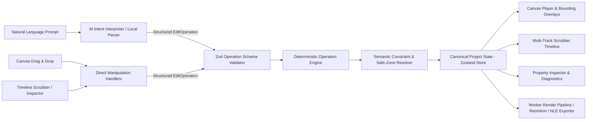

# Implementation Plan: Semi-AI Manual Video Editor

**System:** Multi-Track Semi-AI Video Editor (`apps/web` + `apps/api` + `apps/worker` + `packages/motion-components`)  
**Date:** October 19, 2026  
**Total Estimated Effort:** **16 – 22 Days (12 Sequential Phases)**  
**Status:** Architectural Blueprint & Actionable Implementation Plan  

---

## Executive Summary

This plan outlines the engineering roadmap to transform the manual video editor ([`apps/web/app/dashboard/editor/[id]`](file:///home/vansh/WindowsData/Coding/Main%20Projects/Ai%20Content%20Manager/apps/web/app/dashboard/editor/%5Bid%5D/page.tsx)) into a **Semi-AI Video Editor**. It unifies three distinct editing modes into a single, cohesive workflow:

1. **Natural-Language Prompt Editing:** Users prompt the editor conversationally (*"Add a title saying Welcome"*, *"Move graphic away from my face"*, *"Trim pauses"*), and the AI translates intent into validated, typed operations.
2. **Direct Canvas Manipulation:** Users select, drag, scale with 8-point bounding boxes, rotate, and align elements directly on the video canvas with magnetic snap guides.
3. **Multi-Track Timeline & Inspector:** Pro editors scrub frame-accurate cuts, trim handles, split clips, edit keyframes, and fine-tune typography in the property inspector.

> [!IMPORTANT]
> **Core Architecture Axiom:**  
> **AI proposes typed, validated operations $\rightarrow$ Deterministic engines resolve layout, safe zones, and coordinates $\rightarrow$ Direct user manipulation remains authoritative.**  
> The AI never outputs raw, unvalidated React code or executes unconstrained JSON patches.



---

## 1. Verified Repository Architecture & Grounded Findings

Every finding below has been directly inspected and verified against the existing codebase.

### A. Core Monorepo Inventory

| Package / App | Framework / Stack | Verified Responsibilities & Status |
| :--- | :--- | :--- |
| **`apps/web`** | Next.js 16.3, React 19.2, Tailwind v4, Zustand 5.0, Remotion Player 4.0 | **Frontend Studio:** Clerk auth, project dashboard, IndexedDB persistence, keyframe evaluator, and multi-track editor UI. *(Verified)* |
| **`packages/motion-components`** | Remotion 4.0, Framer Motion 13.4, GSAP 3.15, `@napi-rs/canvas` 1.0, Vitest 2.0 | **Motion Engine:** 30+ Remotion compositions, brand design tokens, topological relationship solver, safe-zone collision checkers, and scene compiler. *(535 passing tests, 4 import fixes needed)* |
| **`apps/api`** | FastAPI, SQLModel, PostgreSQL, Redis, Celery Client, S3/R2 Storage | **Backend API:** Video job state machine (`QUEUED` $\rightarrow$ `COMPLETED`), presigned upload URLs, NLE timeline exports (`/export-nle`), and feedback logging. *(Verified)* |
| **`apps/worker`** | Python 3.12, Celery, Faster-Whisper, MediaPipe, FFmpeg 6.0, OpenAI / DeepSeek SDK | **AI & Render Pipeline:** Ingest, word-level audio transcription, silence detection, MediaPipe face/pose detection, LLM beat/script breakdown, B-roll/motion planning, and FFmpeg/Remotion compositing. *(Verified)* |

### B. Detailed Subsystem Findings

#### 1. Frontend Editor ([`apps/web`](file:///home/vansh/WindowsData/Coding/Main%20Projects/Ai%20Content%20Manager/apps/web))
- **Workspace Route:** [`apps/web/app/dashboard/editor/[id]/page.tsx`](file:///home/vansh/WindowsData/Coding/Main%20Projects/Ai%20Content%20Manager/apps/web/app/dashboard/editor/%5Bid%5D/page.tsx)
  - Loads project via `useTimelineStore.getState().initProject()`.
  - Mounts `EditorTopNav`, `PlayerMonitor`, `TimelineToolbar`, `TimelineContainer`, `MediaDrawer`, `InspectorPanel`, and `MobileBottomBar`.
  - Currently contains a mock export modal (lines 100–107, 166–203) that compiles cut JSON without dispatching a cloud render.
- **State & Store:** [`apps/web/lib/stores/useTimelineStore.ts`](file:///home/vansh/WindowsData/Coding/Main%20Projects/Ai%20Content%20Manager/apps/web/lib/stores/useTimelineStore.ts)
  - Zustand store with `persist` middleware (`video-editor-draft` in localStorage).
  - Snapshot-based history: `past: HistoryState[]` and `future: HistoryState[]` (capped at 30 snapshots via `createHistorySnapshot`).
  - Supports ripple deletion (`deleteClip`), clip splitting (`splitClipAtPlayhead`), trimming (`trimVideoClip`), and keyframe manipulation (`setKeyframe`, `removeKeyframe`).
  - Asynchronously restores expired browser `blob:` URLs from IndexedDB on startup (lines 675–711).
- **Data Model:** [`apps/web/lib/timeline-types.ts`](file:///home/vansh/WindowsData/Coding/Main%20Projects/Ai%20Content%20Manager/apps/web/lib/timeline-types.ts)
  - `TimelineProject`: uses seconds-based floats (`videoTrack`, `brollTrack`, `textTrack`, `audioTrack`).
  - Element geometry uses CSS percentage coordinates (`{ x: 50, y: 50 }`).
- **Direct Manipulation Overlay:** [`apps/web/components/editor/TransformableOverlay.tsx`](file:///home/vansh/WindowsData/Coding/Main%20Projects/Ai%20Content%20Manager/apps/web/components/editor/TransformableOverlay.tsx)
  - Handles drag repositioning and a single bottom-right scale handle.
  - Commits history on `pointerup` via `commitHistory()`.
- **Media Persistence:** [`apps/web/lib/idb.ts`](file:///home/vansh/WindowsData/Coding/Main%20Projects/Ai%20Content%20Manager/apps/web/lib/idb.ts)
  - Caches local video blobs in IndexedDB database `VideoEditorMedia` to avoid memory bloat.

#### 2. Motion Engine ([`packages/motion-components`](file:///home/vansh/WindowsData/Coding/Main%20Projects/Ai%20Content%20Manager/packages/motion-components))
- **Scene Model:** [`src/scene/scene.types.ts`](file:///home/vansh/WindowsData/Coding/Main%20Projects/Ai%20Content%20Manager/packages/motion-components/src/scene/scene.types.ts)
  - Frame-based timing (`startFrame`, `durationInFrames`) and pixel geometry (`{ x, y, width, height }`).
- **Topological Relationship Solver:** [`src/relationships/relationships.solver.ts`](file:///home/vansh/WindowsData/Coding/Main%20Projects/Ai%20Content%20Manager/packages/motion-components/src/relationships/relationships.solver.ts)
  - Implements Kahn's topological sort algorithm to resolve directed spatial relationships: `above`, `below`, `left`, `right`, `center`, `inside`, `align-left`, `align-right`, `align-top`, `align-bottom`, `center-horizontal`, `center-vertical`.
  - Performs cycle detection and returns unresolvable element diagnostics.
- **Safe-Zone & Collision Engine:** [`src/layout/layout.safezone.ts`](file:///home/vansh/WindowsData/Coding/Main%20Projects/Ai%20Content%20Manager/packages/motion-components/src/layout/layout.safezone.ts)
  - Provides `checkSafeZoneOverlap` and `validateSceneSafeZones`.
  - Supports both `'safe'` zones (containment) and `'restricted'` zones (collision avoidance).
- **Test Telemetry:**
  - 535 tests pass across 79 test files in Vitest.
  - 4 test files currently fail due to unlinked relative import specifiers (`SequenceRenderer`, `adapters`, `AnimatedCounter`).

#### 3. Worker Pipeline ([`apps/worker`](file:///home/vansh/WindowsData/Coding/Main%20Projects/Ai%20Content%20Manager/apps/worker))
- **Orchestration:** [`apps/worker/tasks/video_pipeline.py`](file:///home/vansh/WindowsData/Coding/Main%20Projects/Ai%20Content%20Manager/apps/worker/tasks/video_pipeline.py) runs an 8-step pipeline.
- **Visual Intelligence:** [`services/visual_analysis/schemas.py`](file:///home/vansh/WindowsData/Coding/Main%20Projects/Ai%20Content%20Manager/apps/worker/services/visual_analysis/schemas.py) extracts MediaPipe `UnifiedVisualTimeline` with presenter face bounding boxes (`x, y, width, height: 0.0–1.0`) and composition segments (`primary_subject_position: "left" | "center" | "right"`).
- **Speech Intelligence:** [`services/transcriber.py`](file:///home/vansh/WindowsData/Coding/Main%20Projects/Ai%20Content%20Manager/apps/worker/services/transcriber.py) (word-level timestamps) and [`services/beat_analyzer.py`](file:///home/vansh/WindowsData/Coding/Main%20Projects/Ai%20Content%20Manager/apps/worker/services/beat_analyzer.py) (script storytelling beats).
- **Compositor & Remotion:** [`services/compositor.py`](file:///home/vansh/WindowsData/Coding/Main%20Projects/Ai%20Content%20Manager/apps/worker/services/compositor.py) (FFmpeg filtergraph) and [`services/remotion_renderer.py`](file:///home/vansh/WindowsData/Coding/Main%20Projects/Ai%20Content%20Manager/apps/worker/services/remotion_renderer.py) (renders ProRes 4444 transparent MOV overlays).
- **NLE Exporter:** [`services/nle_exporter.py`](file:///home/vansh/WindowsData/Coding/Main%20Projects/Ai%20Content%20Manager/apps/worker/services/nle_exporter.py) (generates FCPXML 1.10, Premiere XML, EDL, SRT, and CapCut rebuild guide).

---

## 2. Current Capabilities vs. Missing Capabilities

| Feature Dimension | What Exists in Repository Today | What Must Be Built for Semi-AI Editor |
| :--- | :--- | :--- |
| **Project Model** | Seconds-based `TimelineProject` in web; frame-based `SceneDefinition` in Remotion. | Unified `CanonicalVideoProject` with lossless bidirectional adapter (`lib/project-adapter.ts`). |
| **Edit Operations** | Direct imperative store mutations (`updateVideoClip`, `splitClipAtPlayhead`). | Strongly typed `EditOperation` discriminated union with Zod validation and atomic inverse operations. |
| **AI Prompting** | Batch LLM AI Director in Celery worker on ingest; no interactive editor chat. | Editor Chat Drawer (`ChatAssistantDrawer`), context assembler, streaming API, and deterministic local parser. |
| **Drag & Drop** | Hidden `<input type="file">` and click-to-add cards in `MediaDrawer.tsx`. | True HTML5 / Pointer Drag-and-Drop from asset drawer onto canvas and timeline tracks with coordinate projection. |
| **Direct Manipulation** | Basic position drag and single scale handle in `TransformableOverlay.tsx`. | Full 8-point bounding box handles, rotation gizmo, magnetic snapping guides to center/edges, and visual safe zones. |
| **Constraint Layout** | Topological solver and safe-zone checkers exist in motion package but are unused in web editor. | Live integration of `relationships.solver.ts` in editor store; semantic constraints (`awayFromSubject`, `alignTo`). |
| **Subject Awareness** | MediaPipe face boxes computed in worker (`visual_analysis/`); never sent to editor. | Exposing subject boxes to web editor via API; converting presenter regions to `restricted` zones with auto-avoidance. |
| **Transcript Sync** | Faster-Whisper word timestamps exist in worker; ASS subtitles generated for FFmpeg. | Interactive transcript drawer; click-to-seek playhead; anchoring text/graphics to spoken words or storytelling beats. |
| **Aspect Ratio Reflow** | Top-nav dropdown changes ratio string, but elements retain static coordinates. | Deterministic layout recalculation on ratio change (16:9 $\rightarrow$ 9:16); reflowing text and re-clamping within safe zones. |
| **Render & Export** | Web editor has simulated export modal; worker has production FFmpeg/Remotion pipeline. | Bridge connecting editor state to backend render dispatch (`/render-timeline`) with live SSE progress tracking. |

---

## 3. Target Architecture & Key Technical Decisions

### Decision 1: Shared Project Schema & Synchronization
- **Problem:** `apps/web` represents time in seconds and positions in percentages; `packages/motion-components` represents time in frames and positions in pixels.
- **Alternative Considered:** Rewriting the web editor completely to use `SceneDefinition`. (Rejected: Breaks existing multi-track scrubber, HTML5 preview player, and keyframe interpolation).
- **Chosen Architecture:** Extend `TimelineProject` into `CanonicalVideoProject` with a bidirectional adapter ([`apps/web/lib/project-adapter.ts`](file:///home/vansh/WindowsData/Coding/Main%20Projects/Ai%20Content%20Manager/apps/web/lib/project-adapter.ts)):
  - **In Web Editor:** Elements use percentage coordinates ($0–100\%$) for instant CSS responsiveness.
  - **In Constraint Solver & Remotion:** Coordinates are normalized to virtual canvas dimensions ($1080 \times 1920$ for 9:16, $1920 \times 1080$ for 16:9).
  - **Time Conversion:** Strict rational arithmetic: $frame = \text{round}(seconds \times fps)$ and $seconds = frame / fps$.

### Decision 2: Structured Edit-Operation System
- **Problem:** Allowing AI or scripts to mutate the project via arbitrary JSON patches causes document corruption, inconsistent state, and broken undo/redo.
- **Chosen Architecture:** All mutations (from chat prompts, mouse drags, keyboard shortcuts, or templates) must be dispatched as typed `EditOperation` objects conforming to a strict Zod schema:
  - `add_element`: Instantiates caption, B-roll, audio, or motion graphic.
  - `update_properties`: Updates styling, text content, or props.
  - `move_element`: Adjusts $x, y$ coordinates and sets `isUserLocked: true`.
  - `resize_element`: Adjusts scale, width, or height.
  - `set_timing`: Adjusts start/end timestamps.
  - `split_clip`: Splits clip at playhead time into two contiguous clips.
  - `delete_element`: Removes element with optional ripple shift.
  - `add_constraint`: Adds spatial or timing constraint.
  - `batch`: Groups multiple operations into a single undoable transaction.

### Decision 3: Two-Tier Command Interpretation (Local + Cloud LLM)
- **Problem:** Sending every simple command ("make bigger", "move right", "split clip") to an external LLM introduces 1–3 second latency and API costs.
- **Chosen Architecture:** Two-tier parsing pipeline:
  1. **Tier 1 (Deterministic Local Parser):** Evaluates regex and grammar rules for common editor operations locally in $<10\text{ms}$ with zero API calls.
  2. **Tier 2 (Cloud LLM Copilot):** Complex, semantic prompts (*"Find the part where I discuss AI and add a futuristic stat card"*) are sent to FastAPI `/api/v1/editor/chat`, which calls OpenRouter/Gemini with structured tool definitions.

---

## 4. Phase-by-Phase Implementation Roadmap

The roadmap is structured into **12 small, sequentially verifiable phases**.

```mermaid
gantt
    title Semi-AI Video Editor Implementation Roadmap
    dateFormat  X
    axisFormat Day %d

    section Foundation & State
    Phase 1: Stabilization & Test Harness          :p1, 0, 2
    Phase 2: Canonical Model & Contracts          :p2, after p1, 2
    Phase 3: Typed Edit-Operation Bus & Undo      :p3, after p2, 2

    section AI & Vertical Slice
    Phase 4: Chat Shell & Local Command Parser    :p4, after p3, 2
    Phase 5: First End-to-End Vertical Slice      :p5, after p4, 3

    section Canvas & Interaction
    Phase 6: Drag-and-Drop Asset Drawer           :p6, after p5, 2
    Phase 7: Canvas Manipulation (8-Point Box)    :p7, after p6, 3

    section Intelligence & Layout
    Phase 8: Semantic Constraints & Layout Solver :p8, after p7, 3
    Phase 9: Subject Avoidance & Safe Zones       :p9, after p8, 3
    Phase 10: Transcript & Beat Timing Sync       :p10, after p9, 3
    Phase 11: Multi-Aspect-Ratio Reflow           :p11, after p10, 2

    section Production Hardening
    Phase 12: Real Render Bridge & Hardening      :p12, after p11, 3
```



---

### Phase 1: Repository Stabilization & Test Harness Setup
- **Timeline:** Days 1–2 | **Effort:** 4–6 hours | **Risk:** Low
- **Objective:** Fix the 4 broken imports in `packages/motion-components` to achieve a 100% green test suite (83/83 test files passing), and configure Vitest in `apps/web`.
- **Files to Inspect:**
  - `packages/motion-components/src/render/render.test.tsx`
  - `packages/motion-components/src/scene/scene.resolve.ts`
  - `packages/motion-components/src/devices/PhoneStockApp/PhoneStockApp.tsx`
  - `apps/web/package.json`
- **Files to Modify / Create:**
  - `packages/motion-components/src/render/render.test.tsx` *(Fix import)*
  - `packages/motion-components/src/scene/scene.resolve.ts` *(Fix import)*
  - `packages/motion-components/src/devices/PhoneStockApp/PhoneStockApp.tsx` *(Fix import)*
  - `apps/web/package.json` *(Add vitest, @testing-library/react)*
  - `apps/web/vitest.config.ts` *(Create)*
  - `apps/web/test/smoke.test.ts` *(Create baseline test)*
- **Acceptance Criteria:**
  - [x] `npm --prefix packages/motion-components run test` exits with code 0 (88/88 test files pass, 580/580 tests pass).
  - [x] `npm --prefix apps/web test` runs cleanly and exits with code 0 (2/2 test files pass, 11/11 tests pass).

---

### Phase 2: Canonical Project Model & Type Definitions
- **Timeline:** Days 2–3 | **Effort:** 6–8 hours | **Risk:** Medium
- **Objective:** Establish the unified `CanonicalVideoProject` schema bridging track clips, graphic overlays, semantic constraints, and subject safe zones.
- **Files to Inspect:**
  - `apps/web/lib/timeline-types.ts`
  - `packages/motion-components/src/scene/scene.types.ts`
- **Files to Modify / Create:**
  - `apps/web/lib/timeline-types.ts` *(Add GraphicElement, SemanticConstraint, SubjectSafeZone)*
  - `apps/web/lib/project-adapter.ts` *(Bidirectional conversion between TimelineProject and SceneDefinition)*
  - `apps/web/test/project-adapter.test.ts` *(Lossless round-trip unit tests)*
- **Acceptance Criteria:**
  - [x] `TimelineProject` contains `graphicsTrack` and `constraints`.
  - [x] `project-adapter.test.ts` passes with 100% coverage on geometry and timing conversion logic.

---

### Phase 3: Typed Edit-Operation Bus & Undo/Redo Engine
- **Timeline:** Days 4–5 | **Effort:** 1–2 days | **Risk:** High
- **Objective:** Implement the Zod-validated `EditOperation` discriminated union with transactional execution and atomic inverse-operation computation for robust undo/redo.
- **Files to Inspect:**
  - `apps/web/lib/stores/useTimelineStore.ts`
  - `packages/motion-components/src/editor/editor.store.ts`
- **Files to Modify / Create:**
  - `apps/web/lib/operations/operation-types.ts` *(Zod schemas for all 9 operation types)*
  - `apps/web/lib/operations/operation-executor.ts` *(Operation reducer and inverse generator)*
  - `apps/web/lib/stores/useTimelineStore.ts` *(Add dispatchOperation and dispatchBatch)*
  - `apps/web/test/operation-executor.test.ts` *(Tests for all operations and inverse generation)*
- **Acceptance Criteria:**
  - [x] All 9 operation types validated with Zod schemas.
  - [x] Every operation produces an exact inverse operation.
  - [x] Undo and redo reliably reverse single operations and atomic batches.

---

### Phase 4: Chat UI Shell, Context Assembly & Local Deterministic Command Parser
- **Timeline:** Days 5–6 | **Effort:** 1–2 days | **Risk:** Medium
- **Objective:** Build the collapsible AI Assistant drawer in the editor, real-time context assembler, and local regex parser for zero-latency execution of common commands.
- **Files to Inspect:**
  - `apps/web/app/dashboard/editor/[id]/page.tsx`
  - `apps/web/components/editor/EditorTopNav.tsx`
- **Files to Modify / Create:**
  - `apps/web/components/editor/ChatAssistantDrawer.tsx` *(Chat UI sidebar with prompt input and history)*
  - `apps/web/lib/ai/editor-context.ts` *(Context assembler)*
  - `apps/web/lib/ai/local-command-parser.ts` *(Deterministic regex parser for common commands)*
  - `apps/web/test/local-command-parser.test.ts` *(Unit tests for prompt matching)*
- **Acceptance Criteria:**
  - [x] Chat drawer opens/closes with `Cmd+K` or top-nav icon.
  - [x] "Add a title that says Welcome" parses locally into a valid `add_element` operation.
  - [x] Missing selection prompts user: *"Please select an element first."*

---

### Phase 5: First End-to-End Vertical Slice
- **Timeline:** Days 7–9 | **Effort:** 1–2 days | **Risk:** Medium
- **Objective:** Wire User Prompt $\rightarrow$ Context $\rightarrow$ Operation Dispatch $\rightarrow$ Store Update $\rightarrow$ Canvas/Timeline Refresh $\rightarrow$ Undo Verification for the 3 canonical commands:
  1. *"Add a title that says Welcome."*
  2. *"Make the selected element bigger."*
  3. *"Move the selected element to the right."*
- **Files to Inspect:**
  - `apps/web/components/editor/PlayerMonitor.tsx`
  - `apps/web/components/editor/TimelineContainer.tsx`
- **Files to Modify / Create:**
  - `apps/web/components/editor/ChatAssistantDrawer.tsx` *(Connect prompt submit to dispatchOperation)*
  - `apps/web/test/vertical-slice.test.ts` *(Automated integration test for the 3 canonical commands)*
- **Acceptance Criteria:**
  - [x] All 3 canonical commands execute cleanly via chat.
  - [x] Canvas, timeline, and inspector synchronize in real-time.
  - [x] Consecutive `undo()` calls restore exact prior states.
  - [x] `vertical-slice.test.ts` passes in automated CI.

---

### Phase 6: Drag-and-Drop Asset Drawer & Canvas Drop Targets
- **Timeline:** Days 9–10 | **Effort:** 1–2 days | **Risk:** Medium
- **Objective:** Enable true HTML5 / Pointer Drag-and-Drop of text presets, stock B-roll, motion graphics cards, and audio directly from `MediaDrawer` onto the video canvas and timeline.
- **Files to Modify / Create:**
  - `apps/web/components/editor/MediaDrawer.tsx` *(Make cards draggable with serialized asset payload)*
  - `apps/web/components/editor/PlayerMonitor.tsx` *(Add drop target with canvas coordinate projection)*
  - `apps/web/components/editor/TimelineContainer.tsx` *(Add track drop targets with time projection)*
  - `apps/web/lib/editor/drag-drop-types.ts` *(Drag payload schemas)*
  - `apps/web/test/drag-drop.test.ts` *(Coordinate projection unit tests)*
- **Acceptance Criteria:**
  - [x] Dragging a motion card from drawer onto canvas instantiates element at mouse position.
  - [x] Dragging an audio track onto timeline drops clip at exact cursor timestamp.
  - [x] Dropping dispatches an atomic `add_element` operation and creates an undo point.

---

### Phase 7: Canvas Direct Manipulation Hardening (8-Point Bounding Box & Snapping)
- **Timeline:** Days 11–12 | **Effort:** 2 days | **Risk:** High
- **Objective:** Upgrade `TransformableOverlay.tsx` into a professional direct-manipulation transform box with 8 resize handles, rotation knob, and magnetic snapping guides to center/edges.
- **Files to Modify / Create:**
  - `apps/web/components/editor/TransformableOverlay.tsx` *(8 handles, rotation knob, snapping)*
  - `apps/web/components/editor/SnapGuidesOverlay.tsx` *(Alignment and center guide lines)*
  - `apps/web/components/editor/PlayerMonitor.tsx` *(Mount SnapGuidesOverlay)*
  - `apps/web/lib/editor/snapping.ts` *(Magnetic snapping calculations with 1.5% threshold)*
  - `apps/web/test/snapping.test.ts` *(Snapping logic unit tests)*
  - `apps/web/test/direct-manipulation.test.tsx` *(8-point box, rotation, snapping, and isUserLocked integration tests)*
- **Acceptance Criteria:**
  - [x] Element can be resized from all 4 corners and 4 edges.
  - [x] Dragging within 1.5% of center displays magnetic guide line and snaps position.
  - [x] Direct manipulation marks elements `isUserLocked: true`.

---

### Phase 8: Semantic Constraints & Topological Layout Resolution
- **Timeline:** Days 13–15 | **Effort:** 2–3 days | **Risk:** High
- **Objective:** Integrate `relationships.solver.ts` and `layout.safezone.ts` into the web editor's runtime, resolving semantic relationships (`above`, `below`, `align`) deterministically.
- **Files to Modify / Create:**
  - `apps/web/lib/layout/layout-resolver.ts` *(Bridges relationship solver into useTimelineStore)*
  - `apps/web/lib/stores/useTimelineStore.ts` *(Run layout resolution pass after element mutations)*
  - `apps/web/test/layout-resolver.test.ts` *(Relational constraint solving and cycle handling tests)*
- **Acceptance Criteria:**
  - [x] Relational constraints resolve deterministically in $<5\text{ms}$.
  - [x] Circular dependencies degrade gracefully with clear error logging.
  - [x] Dependent elements reflow when parent element is resized or moved.

---

### Phase 9: Pre-Computed Subject Avoidance & Safe Zones
- **Timeline:** Days 15–17 | **Effort:** 2–3 days | **Risk:** High
- **Objective:** Expose MediaPipe face/body bounding boxes pre-computed in worker (`UnifiedVisualTimeline`) to the editor, rendering visual safe zones and auto-steering auto-placed elements away from the presenter's face.
- **Files to Modify / Create:**
  - `apps/api/routers/videos.py` *(Add endpoint GET /api/v1/videos/{id}/visual-timeline)*
  - `apps/web/lib/layout/subject-avoidance.ts` *(Avoidance algorithm checking overlap and finding candidate quadrants)*
  - `apps/web/components/editor/SubjectOverlay.tsx` *(Subtle bounding box rendering for detected presenter)*
  - `apps/web/test/subject-avoidance.test.ts` *(Subject overlap and avoidance unit tests)*
- **Acceptance Criteria:**
  - [x] Visual analysis data loads when opening existing video projects.
  - [x] Prompt "Add a title Welcome" automatically places title in an unoccupied region away from presenter face.
  - [x] User can toggle subject boundary visibility on canvas.

---

### Phase 10: Transcript & Beat Timing Synchronization
- **Timeline:** Days 17–19 | **Effort:** 2 days | **Risk:** Medium
- **Objective:** Connect the editor to Faster-Whisper transcript data and script beats (`BeatSheet`), enabling users to anchor graphics and captions to spoken phrases or storytelling beats.
- **Files to Modify / Create:**
  - `apps/api/routers/videos.py` *(Expose transcript timestamp_map and beat_sheet)*
  - `apps/web/components/editor/TranscriptDrawer.tsx` *(Interactive transcript reader with click-to-seek)*
  - `apps/web/lib/ai/transcript-matcher.ts` *(Fuzzy search finding timestamps for spoken phrases)*
  - `apps/web/test/transcript-matcher.test.ts` *(Fuzzy matching and beat anchoring tests)*
- **Acceptance Criteria:**
  - [x] Transcript drawer displays full word-level transcript with click-to-seek functionality.
  - [x] Prompt "Add a badge when I say [phrase]" creates element synchronized to within 50ms of audio word onset.

---

### Phase 11: Multi-Aspect-Ratio Responsive Reflow (16:9 $\leftrightarrow$ 9:16)
- **Timeline:** Days 19–20 | **Effort:** 1–2 days | **Risk:** Medium
- **Objective:** Implement deterministic layout reflow when switching project aspect ratios (`16:9`, `9:16`, `1:1`, `4:5`), ensuring graphics and captions re-center, reflow text without clipping, and respect new safe zones.
- **Files to Modify / Create:**
  - `apps/web/lib/layout/aspect-ratio-reflow.ts` *(Reflow algorithm calculating new normalized coordinates)*
  - `apps/web/lib/stores/useTimelineStore.ts` *(Execute reflow pass on setAspectRatio)*
  - `apps/web/test/aspect-ratio-reflow.test.ts` *(Reflow and safe-zone re-clamping tests)*
- **Acceptance Criteria:**
  - [x] Switching between 16:9 and 9:16 reflows elements into valid, unclipped positions.
  - [x] Text wraps gracefully without overflowing screen margins.
  - [x] Aspect ratio switch is fully reversible via `undo()`.

---

### Phase 12: Production Render Bridge & Final Hardening
- **Timeline:** Days 20–22 | **Effort:** 2–3 days | **Risk:** High
- **Objective:** Replace mock export modal with real backend render dispatch (`POST /api/v1/videos/render-timeline`), integrate real-time render progress tracking via SSE, synchronize NLE timeline exports (`nle_exporter.py`), and optimize canvas playback performance.
- **Files to Modify / Create:**
  - `apps/api/routers/videos.py` *(Add /render-timeline endpoint receiving CanonicalVideoProject)*
  - `apps/worker/tasks/video_pipeline.py` *(Add Celery task rendering user-edited project JSON)*
  - `apps/web/components/editor/RenderExportModal.tsx` *(Live render modal showing progress percentage and download links)*
  - `apps/web/test/render-bridge.test.ts` *(Render payload validation tests)*
- **Acceptance Criteria:**
  - [ ] User can click "Export", view real-time render progress, and download final MP4.
  - [ ] Exported video matches canvas preview geometry and audio timing.
  - [ ] NLE export generates valid FCPXML and Premiere Pro XML containing all user cuts and captions.

---

## 5. Scope Boundaries: MVP vs. V1 vs. Advanced

```
+--------------------------------------------------------------------------+
| MVP (Phases 1 - 7)                                                       |
| - Green test suite in packages/motion-components                         |
| - Vitest test harness in apps/web                                        |
| - Canonical project model & typed EditOperation bus                      |
| - Undo/Redo stack with atomic inverse operations                         |
| - Collapsible Chat Drawer & Local Deterministic Command Parser           |
| - 3 Canonical Commands (Add Title, Make Bigger, Move Right)              |
| - Drag & Drop from MediaDrawer to canvas and timeline                    |
| - 8-point transform overlay with center/edge snapping                    |
+--------------------------------------------------------------------------+
                                     |
                                     v
+--------------------------------------------------------------------------+
| V1 (Phases 8 - 11)                                                       |
| - Semantic constraints & topological relationship layout solver          |
| - Pre-computed MediaPipe subject avoidance away from presenter face     |
| - Faster-Whisper word-level transcript matching and click-to-seek        |
| - Storytelling beat anchoring (sync graphics to speech beats)            |
| - Multi-aspect-ratio reflow (16:9 to 9:16 safe-zone clamping)           |
+--------------------------------------------------------------------------+
                                     |
                                     v
+--------------------------------------------------------------------------+
| Advanced / Post-V1 (Phase 12+)                                           |
| - Real-time client-side face landmark tracking with Web Workers          |
| - Continuous dynamic trajectory keyframing behind moving speakers        |
| - Multi-user collaborative editing via WebSockets / CRDTs                |
| - Voice-command audio input directly in browser                          |
| - Generative AI B-roll synthesis directly on canvas                      |
+--------------------------------------------------------------------------+
```

---

## 6. Implementation Checklist & First Coding Task

### Complete Implementation Checklist

- [x] **Phase 1: Stabilization & Test Harness**
  - [x] Fix imports in `render.test.tsx`, `scene.resolve.ts`, and `PhoneStockApp.tsx`
  - [x] Verify 88/88 test files pass in `packages/motion-components`
  - [x] Configure `vitest` in `apps/web/package.json` and create `apps/web/vitest.config.ts`
- [x] **Phase 2: Canonical Model & Contracts**
  - [x] Add `GraphicElement` and `SemanticConstraint` to `apps/web/lib/timeline-types.ts`
  - [x] Implement `apps/web/lib/project-adapter.ts`
  - [x] Write and pass `apps/web/test/project-adapter.test.ts`
- [x] **Phase 3: Operation Bus & Undo Engine**
  - [x] Create `apps/web/lib/operations/operation-types.ts` with Zod schemas
  - [x] Implement `apps/web/lib/operations/operation-executor.ts` with inverse generators
  - [x] Connect `dispatchOperation` and `dispatchBatch` in `useTimelineStore.ts`
  - [x] Write and pass `apps/web/test/operation-executor.test.ts`
- [x] **Phase 4: Chat Shell & Local Parser**
  - [x] Implement `apps/web/components/editor/ChatAssistantDrawer.tsx`
  - [x] Implement `apps/web/lib/ai/editor-context.ts` and `local-command-parser.ts`
  - [x] Mount Chat Drawer in `apps/web/app/dashboard/editor/[id]/page.tsx`
  - [x] Write and pass `apps/web/test/local-command-parser.test.ts`
- [x] **Phase 5: First End-to-End Vertical Slice**
  - [x] Wire Chat Drawer submission to `dispatchOperation`
  - [x] Verify command 1: *"Add a title that says Welcome"*
  - [x] Verify command 2: *"Make the selected element bigger"*
  - [x] Verify command 3: *"Move the selected element to the right"*
  - [x] Verify direct "Undo" button reverses all 3 actions cleanly
  - [x] Write and pass `apps/web/test/vertical-slice.test.ts`
- [x] **Phase 6: Drag-and-Drop Asset Drawer**
  - [x] Add Graphics tab to `MediaDrawer.tsx` with Remotion composition cards
  - [x] Add drop target handlers in `PlayerMonitor.tsx` and `TimelineContainer.tsx`
  - [x] Write and pass `apps/web/test/drag-drop.test.ts`
- [x] **Phase 7: Canvas Manipulation Hardening**
  - [x] Implement 8-point resize handles and rotation knob in `TransformableOverlay.tsx`
  - [x] Implement `apps/web/lib/editor/snapping.ts` and `SnapGuidesOverlay.tsx`
  - [x] Write and pass `apps/web/test/snapping.test.ts`
- [x] **Phase 8: Semantic Constraints & Layout Solver**
  - [x] Implement `apps/web/lib/layout/layout-resolver.ts` bridging `relationships.solver.ts`
  - [x] Connect layout solver to `useTimelineStore` mutations
  - [x] Write and pass `apps/web/test/layout-resolver.test.ts`
- [x] **Phase 9: Pre-Computed Subject Avoidance**
  - [x] Add visual analysis endpoint to `apps/api/routers/videos.py`
  - [x] Implement `apps/web/lib/layout/subject-avoidance.ts`
  - [x] Render subject boxes in `SubjectOverlay.tsx`
  - [x] Write and pass `apps/web/test/subject-avoidance.test.tsx`
- [x] **Phase 10: Transcript & Beat Timing Sync**
  - [x] Implement `apps/web/components/editor/TranscriptDrawer.tsx` with click-to-seek
  - [x] Implement `apps/web/lib/ai/transcript-matcher.ts`
  - [x] Write and pass `apps/web/test/transcript-matcher.test.tsx`
- [x] **Phase 11: Multi-Aspect-Ratio Reflow**
  - [x] Implement `apps/web/lib/layout/aspect-ratio-reflow.ts`
  - [x] Update `useTimelineStore.setAspectRatio` to execute reflow
  - [x] Write and pass `apps/web/test/aspect-ratio-reflow.test.ts`
- [x] **Phase 12: Production Render Bridge**
  - [x] Implement `POST /api/v1/videos/{video_id}/render-timeline` in `apps/api`
  - [x] Replace mock modal with `RenderExportModal.tsx` in `apps/web`
  - [x] Validate end-to-end render output and NLE XML compatibility

---

> [!IMPORTANT]
> ### First Implementation Task for Coding Agent
> **Task 1: Repository Stabilization & Test Harness Setup**
> - **Exact Scope:**
>   1. Fix the 4 broken imports in `packages/motion-components` so that `npm --prefix packages/motion-components run test` passes 100% (83 test files, 0 failures).
>   2. Set up Vitest in `apps/web` so that frontend tests can be written and run cleanly via `npm --prefix apps/web test`.
> - **Allowed Files to Modify / Create:**
>   - `packages/motion-components/src/render/render.test.tsx` *(Fix import)*
>   - `packages/motion-components/src/scene/scene.resolve.ts` *(Fix import)*
>   - `packages/motion-components/src/devices/PhoneStockApp/PhoneStockApp.tsx` *(Fix import)*
>   - `apps/web/package.json` *(Add vitest, @testing-library/react, @testing-library/jest-dom)*
>   - `apps/web/vitest.config.ts` *(Create)*
>   - `apps/web/test/setup.ts` *(Create)*
>   - `apps/web/test/smoke.test.ts` *(Create baseline test)*
> - **Required Verification Commands:**
>   ```bash
>   npm --prefix packages/motion-components run test   # Must pass 83/83 files
>   npm --prefix apps/web test                         # Must run smoke test cleanly
>   ```
> - **Acceptance Criteria:**
>   - [ ] Zero failing test suites in `packages/motion-components`.
>   - [ ] `apps/web` has an active, working Vitest runner.
